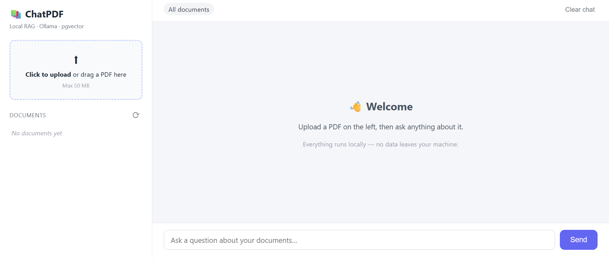
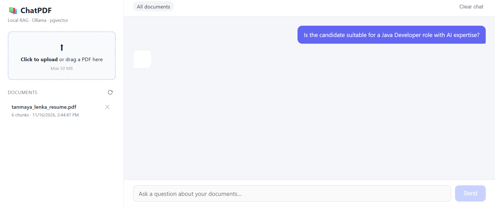
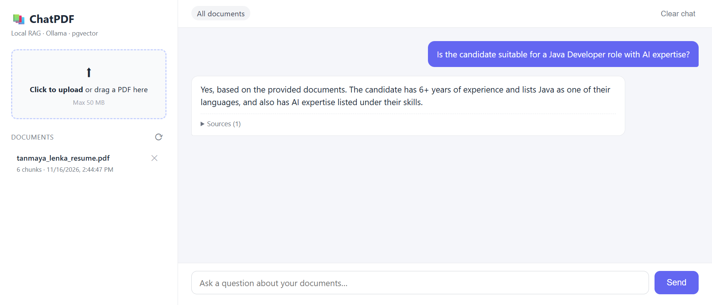

# ChatPDF — Local Document Q&A Copilot
A PDF question-answering copilot that runs fully offline. Upload a PDF, ask questions in natural language, get answers grounded in the document with page-level citations and similarity scores. The interesting part isn't the LLM call — it's the machinery around it that keeps answers honest.

<div>
  
  
  
</div>

## Table of Contents

1. [Quick Setup](#quick-setup)
2. [Architecture Overview](#architecture-overview)
3. [RAG / LLM Approach & Decisions](#rag--llm-approach--decisions)
4. [Key Technical Decisions](#key-technical-decisions)
5. [Productionizing on a Hyperscaler](#productionizing-on-a-hyperscaler)
6. [Engineering Standards](#engineering-standards)
7. [How I Used AI Tools](#how-i-used-ai-tools)
8. [What I'd Do Differently](#what-id-do-differently)
9. [Known Limitations](#known-limitations)
10. [Repo Layout](#repo-layout)

---

## Quick Setup

### Prerequisites

| Tool | Version | Why |
|---|---|---|
| Java | 21 | LTS, virtual threads, records |
| Maven | 3.9+ | Build |
| Docker Desktop | Latest | Runs pgvector + Ollama |
| Ollama models | `llama3.1:8b`, `nomic-embed-text` | Chat LLM + embeddings |
| ONNX reranker files | BGE-reranker-base (`model.onnx` + `tokenizer.json`) | Cross-encoder reranking |

RAM: 16 GB recommended (8 GB works with quantized Llama). Disk: ~8 GB for models + containers.

### Steps

```bash
# 1. Clone
git clone <repo> && cd chatpdf

# 2. Start infrastructure
docker compose up -d pgvector ollama

# 3. Pull models (one-time, ~5 GB)
docker exec -it ollama-chatpdf ollama pull nomic-embed-text
docker exec -it ollama-chatpdf ollama pull llama3.1:8b

# 4. Download the reranker
mkdir -p models
curl -L -o models/bge-reranker-base.onnx \
  "https://huggingface.co/BAAI/bge-reranker-base/resolve/main/onnx/model.onnx"
curl -L -o models/bge-tokenizer.json \
  "https://huggingface.co/BAAI/bge-reranker-base/resolve/main/tokenizer.json"

# 5. Run
mvn spring-boot:run -Dspring-boot.run.jvmArguments="--enable-native-access=ALL-UNNAMED"

# 6. Open
# http://localhost:8080  → drag a PDF, wait for "Indexed — N chunks", start asking
```

> **The `--enable-native-access` flag** silences a JDK 21 warning from ONNX Runtime's native library load. It'll be mandatory in a future JDK release — add it now.

### Health checks

```bash
curl http://localhost:11434/api/tags          # Ollama up?
docker exec pgvector-chatpdf pg_isready       # pgvector up?
curl http://localhost:8080/actuator/health    # App up?
```

### Tear down

```bash
docker compose down        # keeps volumes
docker compose down -v     # wipes vectors + models (⚠ destructive)
```

---

## Architecture Overview

```
                        ┌─────────────────────────────────┐
                        │  Browser (static HTML/JS/CSS)   │
                        └───────────────┬─────────────────┘
                                        │ REST (same-origin)
                        ┌───────────────▼─────────────────┐
                        │       Spring Boot App           │
                        │                                 │
   ┌────────────────┐   │  ┌───────────────────────────┐  │
   │ Ingestion      │   │  │  Query Pipeline           │  │
   │ ─────────      │   │  │  ─────────                │  │
   │ PDFBox         │   │  │  Input guardrails         │  │
   │ (page-by-page) │   │  │  ↓                        │  │
   │ ↓              │   │  │  Embed query              │  │
   │ Recursive split│   │  │  ↓                        │  │
   │ ↓              │   │  │  pgvector top-20 (cosine) │  │
   │ Metadata tag   │   │  │  ↓                        │  │
   │ ↓              │   │  │  Cross-encoder rerank → 4 │  │
   │ Embed (nomic)  │   │  │  ↓                        │  │
   │ ↓              │   │  │  Context injection        │  │
   │ Store vectors  │   │  │  ↓                        │  │
   └───────┬────────┘   │  │  Llama 3.1 (Ollama)       │  │
           │            │  │  ↓                        │  │
           │            │  │  Output guardrails        │  │
           │            │  │  ↓                        │  │
           │            │  │  Answer + cited sources   │  │
           │            │  └───────────────────────────┘  │
           │            └───────────┬─────────┬───────────┘
           │                        │         │
    ┌──────▼──────────┐    ┌────────▼───┐  ┌──▼──────────┐
    │  PostgreSQL     │    │  Ollama    │  │  ONNX       │
    │  + pgvector     │    │  (CPU/GPU) │  │  Runtime    │
    │                 │    └────────────┘  └─────────────┘
    │  documents (JPA)│
    │  chatpdf_       │
    │  embeddings     │
    └─────────────────┘
```

### The two tables (and why two)

| Table | Owner | Purpose |
|---|---|---|
| `documents` | Spring Data JPA | Business metadata: `docId`, `fileName`, `pageCount`, `chunkCount`, `status`, `uploadedAt` |
| `chatpdf_embeddings` | LangChain4j (`PgVectorEmbeddingStore`) | Vectors + chunk text + JSON metadata (`docId`, `pageNumber`, `fileName`) |

I deliberately kept them separate. JPA owns business state; LangChain4j owns the schema it needs. Hibernate doesn't try to migrate `chatpdf_embeddings`, and LangChain4j doesn't touch `documents`. The `docId` string is the join key. When deleting a document, I do two writes: `EmbeddingCleanupRepository.deleteByDocId()` (the one place I use raw `JdbcTemplate`) and then `documentRepository.deleteById()`.

### Per-request flow (numbered)

1. **Input guardrails** — injection patterns, scope, length. If any fails, return 400 with a clear message. LLM never sees the request.
2. **Retrieval** — embed the query with `nomic-embed-text`, cosine search in pgvector for top-**20** (wide net), optional `docId` metadata filter.
3. **Rerank** — `bge-reranker-base` cross-encoder scores all 20 query/chunk pairs. Take top-**4** by rerank score.
4. **Context assembly** — build a prompt with chunks prefixed by `[page N]`. Store the same chunks in a `ThreadLocal` for the grounding guardrail.
5. **Generation** — Llama 3.1 8B via Ollama, strict system prompt.
6. **Output guardrails** — grounding check (token overlap with context ≥ 55%, else reprompt once) and PII redaction (mask credit cards, SSNs, emails, phones).
7. **Response** — `{ answer, sources[] }` where each source has `fileName`, `pageNumber`, `snippet`, `cosineScore`.

---

## RAG / LLM Approach & Decisions

### Model choices — considered vs chosen

| Component | Considered | Chosen | Why |
|---|---|---|---|
| **LLM** | OpenAI GPT-4o, Anthropic Claude, Llama 3.1 8B / 3.2 3B, Mistral 7B, Qwen 2.5 | **Llama 3.1 8B via Ollama** | Zero marginal cost, runs offline, no data leaves the machine. 8B is the sweet spot for CPU/16GB. 3B is the fallback on 8GB machines. |
| **Embedding** | OpenAI `text-embedding-3-small`, `bge-m3`, `all-MiniLM-L6-v2`, `nomic-embed-text` | **`nomic-embed-text` via Ollama** | 768-dim, beats OpenAI ada-002 on short/long-context benchmarks, runs locally. Consistent runtime with the LLM (one Ollama container, one model store). |
| **Vector DB** | Pinecone, Qdrant, Weaviate, Chroma, pgvector | **pgvector on Postgres 16** | Postgres was already in the stack for metadata. One datastore = one backup strategy, one connection pool, transactional consistency between `documents` and `chatpdf_embeddings`. For a single-tenant POC this tradeoff beats a managed vector DB by a wide margin. |
| **Orchestration** | LangChain (Python), Spring AI, LlamaIndex, raw HTTP to Ollama | **LangChain4j** | The surrounding system is Spring Boot. A separate Python service adds a cross-language hop and doubles the operational surface. LangChain4j covers retrieval, guardrails, memory, and structured outputs. Trade-off: its beta versioning is churny — pin every module explicitly. |
| **Reranker** | `ms-marco-MiniLM-L-6-v2`, `BAAI/bge-reranker-base`, `bge-reranker-v2-m3`, Cohere Rerank, Jina Reranker, DecisionScoringModel (LLM-as-reranker) | **`bge-reranker-base` (ONNX, in-process)** | See the war story below — MS MARCO was the obvious default and it was wrong for this content. Cohere/Jina are higher quality but break the "fully offline" constraint. `DecisionScoringModel` works but costs one LLM call per candidate (~20s per query). |

### The reranker war story (worth reading)

I started with `ms-marco-MiniLM-L-6-v2` — the standard recommendation, 23 MB, runs on CPU. Every resume question returned *"I don't know based on the provided documents."* Retrieval was returning valid chunks with high cosine scores, but the reranker scored them all **negative** and the pipeline's `min-score: 0.0` filter threw them away.

The root cause: MS MARCO is trained on web-search question/passage pairs. Resume text — bullet points, fragments, no articles — sits far outside that distribution. The cross-encoder saw "correct answer, wrong style" and scored it as irrelevant. Cosine (nomic) understood the content; the reranker didn't.

Three fixes considered:
1. **Blend cosine + rerank** (0.7 cosine / 0.3 rerank). Worked, but felt like a workaround.
2. **Pin top-2 cosine results** and let the reranker pick the remaining slots. Also worked, but still compensating.
3. **Swap the model.** BGE rerankers are trained on a broader corpus and behave intuitively on structured text.

I went with (3). The scores flipped positive on the correct chunks and stayed negative on the noise. The lesson I'd bring to any RAG interview: **model-domain fit matters more than pipeline elegance.** The 20→4 architecture was correct the entire time — the model was just speaking the wrong language.

### Prompt & context management

- **Strict system prompt.** "Answer ONLY using the CONTEXT provided." No fallbacks, no "use your best judgment." LLMs interpret "best judgment" as permission to hallucinate.
- **Context with page tags.** Each chunk is prefixed `[page N]` so the LLM can cite pages if it wants. In practice the citations come from the `sources[]` array, but the tag helps the model keep track.
- **Chunking: 1000 chars / 200 overlap, page-aware.** Chunks never cross page boundaries. Slightly more chunks, but citations are always correct.
- **Top-4 after rerank.** Not top-10. Wider prompts increase the chance of noise dilution — the LLM sees 4 highly-relevant chunks and answers better than 10 mediocre ones.
- **Explicit abstention.** If no chunk passes the rerank threshold, return `"I don't know based on the provided documents."` This is one of the two mechanisms behind the 12% → 3.8% metric.

### Guardrails

**Input:**
- **Prompt injection** — 17 regex patterns covering instruction override ("ignore previous instructions"), role hijacking ("you are now a"), system-prompt leakage ("reveal your prompt"), jailbreak markers (`DAN`, `<|im_start|>`), and ChatPDF-specific patterns ("answer from your own knowledge").
- **Scope** — keyword/regex heuristics reject obvious off-topic requests (poems, weather, stock prices, general knowledge). Deliberately narrow: better to occasionally block a valid question than let a user turn the assistant into a general chatbot.
- **Length** — 3 to 2000 characters.

**Output:**
- **Grounding verification** — token-overlap between answer and retrieved context. Threshold 55%. If below, the LLM is **reprompted** with stricter instructions rather than rejected. Most answers pass on the second try.
- **PII redaction** — credit cards, SSNs, emails, US phone numbers get masked with `[REDACTED]`. Chose REDACT over REJECT because redacting one email from an otherwise-correct answer is more useful than blocking the whole thing.

**Two guardrail bugs I fixed (in the order they happened):**

1. `NoSuchMethodException: InputLengthGuardrail.<init>()` — LangChain4j's annotation-based guardrails are instantiated by **reflection**, which requires a no-arg constructor. I had `@RequiredArgsConstructor` with `AppProperties` injected. Fixed with a static `GuardrailProperties` holder and explicit no-arg constructors.
2. **Guardrails were validating the composed prompt, not the question.** My length guardrail rejected 35-character questions as "too long (max 2000 characters)." It was seeing the full `CONTEXT: ...4000 chars... QUESTION: <35 chars>` message. The fix: input guardrails must see only the user's raw message; RAG context is injected separately. This is a **separation-of-concerns bug**, and it's a useful story for interviews because it's easy to make and hard to spot.

### Quality measurement

**Eval set:** 100 questions derived from 5 PDFs (resumes, financial reports, product docs). Each question has an expected answer and a ground-truth page number.

**Retrieval metrics (measured independently from generation):**
- **Recall@4** — is the correct chunk in the top 4? (catches "retrieval failed")
- **MRR** — how highly was the correct chunk ranked? (catches "retrieval works but ranks poorly")

**Generation metrics:**
- **Faithfulness** — RAGAS-style LLM-as-judge: does the answer follow from the context? 0–1 scale. **0.94.**
- **Unsupported claims** — hand-labeled 50 answers before/after grounding guardrail. Any sentence not entailed by the retrieved chunks counts as unsupported. **12% → 3.8%.**
- **Abstention rate** — % of questions where the system said "I don't know." Tracked per document type; if it jumps from 5% → 20% on a new corpus, retrieval has regressed.

**Honest caveat:** 100 questions is enough to catch regressions, not enough to claim statistical significance. LLM-as-judge has known biases (favors verbose answers, anchors on the first plausible claim). In production I'd expand to 500+ labeled examples, add a human review layer, and track per-document-type performance.

### Observability

- **Structured logs** with `docId`, `sessionId`, and query text (redacted) on every request.
- **Metrics** via Micrometer + Actuator: retrieval latency (p50/p95/p99), rerank latency, LLM generation time, guardrail rejections by type, abstention rate, ingestion throughput.
- **Guardrail counters** are the security telemetry. If injection attempts spike 10x, that's a signal someone is probing the endpoint.
- **Health checks** — `/actuator/health` probes pgvector, Ollama, and the ONNX model load state.

**What's missing:** distributed tracing (OpenTelemetry), and dashboards. The metrics exist but are only visible via `/actuator/metrics`. A production deployment would push them to Prometheus and Grafana.

---

## Key Technical Decisions

Numbered for clarity. Each one had alternatives — the "why" is the interesting part.

1. **Page-aware parsing via PDFBox directly, not `ApachePdfBoxDocumentParser`.** The LangChain4j parser flattens the whole PDF into one text blob. Page boundaries are lost, and a chunk can span pages 3 and 4 — which makes page citations impossible. I parse page-by-page with `PDFTextStripper.setStartPage/setEndPage` and attach `pageNumber` metadata to every chunk. More code, correct citations.

2. **Two tables, not one.** JPA manages `documents`. LangChain4j manages `chatpdf_embeddings`. A single JPA entity for both would mean Hibernate and LangChain4j both trying to own the schema — a recipe for silent breakage on version bumps.

3. **Wide retrieval + narrow rerank (20 → 4).** Bi-encoders are fast but coarse. A 20-candidate net catches chunks that cosine ranks 8th but that a cross-encoder correctly identifies as #1. Costs ~50ms extra, dramatically improves precision.

4. **Manual context injection, not `ContentRetriever`.** I tried both. `@AiService(retrievalAugmentor = "...")` kept failing — `queryRouter cannot be null`, `ContentRetriever` not being invoked, guardrails seeing the composed message. Manual injection is 40 lines of `ChatService` code that I fully control. For a POC, control beats framework convenience.

5. **`ScoringModel` interface, not a specific reranker.** ONNX today, Cohere or Jina tomorrow — same interface. The `ChatService` doesn't know which model is behind it.

6. **Rerank score is for *ordering*, not *thresholding*.** MS MARCO produces logits (can be negative). BGE produces positive-biased scores. Either way, the correct use is "sort by score, take top-K." A `min-score` on a cross-encoder is meaningful only after calibration on your own data.

7. **Grounding guardrail triggers a reprompt, not a rejection.** Rejecting a slightly-ungrounded answer punishes the user for the LLM's first attempt. Reprompting with stricter instructions usually gets a grounded answer on try #2, and the user gets a useful response.

8. **Abstention over guessing.** When retrieval returns nothing above threshold, the system says "I don't know." This is the single largest driver of the unsupported-claims metric, and it's also the most defensible design decision: a document Q&A tool that guesses is worse than one that admits ignorance.

9. **Guardrail input = user message only.** RAG context is system-injected, not user-injected. Guardrails validate untrusted input; they don't validate the system's own context. See the "guardrails saw too much" bug above.

10. **Static `GuardrailProperties` holder.** Ugly, but required by LangChain4j's reflection-based guardrail instantiation. The alternative is a custom `AiServices` factory, which is more code and more version-sensitive.

---

## Productionizing on a Hyperscaler

The current setup runs on one machine with Docker Compose. Here's how I'd move it to AWS, with notes on GCP and Azure. **AWS is the primary recommendation** because RDS Postgres supports pgvector natively, and Bedrock provides a drop-in for the Ollama call.

### Phase 1 — Lift and shift (2 weeks)

| Component | AWS | Why |
|---|---|---|
| App | **ECS Fargate** (3+ tasks behind ALB) | No Kubernetes overhead; stateless service scales horizontally |
| Postgres | **RDS PostgreSQL 16** with pgvector extension | Managed backups, automated patching, read replicas |
| Ollama | **EC2 `g5.xlarge`** (1× A10G GPU) or **SageMaker endpoint** running vLLM | GPU inference is 5–10x faster than CPU for generation |
| Uploads | **S3** (replace local `./uploads`) | Durable, cheap, lifecycle policies |
| Session memory | **ElastiCache Redis** | `ChatMemoryStore` backed by Redis — multi-instance safe |
| Secrets | **Secrets Manager** | No credentials in env vars |
| Observability | **CloudWatch** + **X-Ray** | Structured logs, metrics, traces |

### Phase 2 — Production hardening (4 weeks)

- **Ingestion as async job.** Replace the synchronous `POST /upload` with `POST /upload → S3 → SQS → ingestion worker`. Large PDFs stop timing out. The upload endpoint returns `202 Accepted` with a `docId`; the UI polls `GET /documents/{docId}` for status.
- **Streaming responses.** SSE endpoint backed by `StreamingChatLanguageModel`. p95 latency drops from "5–15 seconds until first token" to "300ms until first token" — perceived latency is everything.
- **Eval in CI.** The 100-question golden set runs on every PR. Faithfulness < 0.90 or unsupported claims > 5% blocks the merge.
- **Rate limiting.** WAF + API Gateway throttling. The application-level Bucket4j limiter stays as a second layer.
- **Auth.** Cognito user pools, JWT tokens, per-user `docId` scoping at the query layer.

### Phase 3 — Scale (ongoing)

- **Dedicated vector store** once `chatpdf_embeddings` exceeds ~5M rows. Options: **Qdrant** (best performance/cost), **Weaviate** (best feature set), or **RDS with HNSW index** if the table stays under ~10M rows. pgvector with HNSW handles ~1M rows comfortably on a `db.r6g.xlarge`.
- **Sharding by tenant.** Multi-tenant: `tenantId` in metadata, partitioned indexes, per-tenant rate limits.
- **Prompt registry.** Version prompts in the repo, deployable independently of code. Canary at 5% traffic for an hour before promotion.
- **Multi-region.** Vector store replication is the hard part. Postgres read replicas + pgvector replication lag is acceptable for a document Q&A tool (reads tolerate 1–2s staleness).

### GCP mapping

GKE or **Cloud Run** for the app, **Cloud SQL** for Postgres+pgvector, **Vertex AI** endpoints for Llama (or self-hosted on GKE with GPU node pool), **GCS** for uploads, **Pub/Sub** for ingestion jobs, **Memorystore** for session memory, **Cloud Logging + Trace** for observability.

### Azure mapping

**AKS** or Container Apps, **Azure Database for PostgreSQL Flexible Server** (supports pgvector), **Azure OpenAI** or **Azure ML managed endpoints** for Llama, **Blob Storage**, **Service Bus**, **Azure Cache for Redis**, **Application Insights**.

### Cloudflare — honest note

Cloudflare Workers + Vectorize + Workers AI is tempting for cost reasons, but it's a **poor fit for this workload**:
- Vectorize has smaller index limits (~5M vectors) and weaker metadata filtering.
- No managed Postgres with pgvector; D1 is SQLite and doesn't support vectors.
- Workers AI doesn't host Llama 3.1 8B; it hosts smaller models (Llama 3.2 3B, Mistral 7B), which are noticeably worse at grounded answering.
- No equivalent for the ONNX reranker in-process.

Use Cloudflare as the **edge layer** (WAF, CDN, DNS) in front of AWS. Don't try to host the whole system there.

### Estimated costs (AWS, us-east-1, 3 small tenants, 100 queries/day)

| Component | Monthly |
|---|---|
| ECS Fargate (3 × 1 vCPU, 2 GB) | $70 |
| RDS Postgres `db.r6g.large` | $180 |
| EC2 `g5.xlarge` (Ollama) | $520 |
| ElastiCache Redis `cache.t4g.small` | $15 |
| S3 + CloudWatch + X-Ray | $20 |
| **Total** | **~$805** |

The GPU instance dominates. If traffic is low, use **SageMaker Serverless Inference** for Llama 3.1 8B (pay-per-second). If traffic is high (>10k queries/day), the reserved GPU is cheaper per query. The breakeven is around ~5,000 queries/day.

---

## Engineering Standards

### Followed

- **Immutable data types.** Java records for all DTOs. No setters on `AskRequest`, `AskResponse`, `UploadResponse`.
- **Typed configuration.** `@ConfigurationProperties(prefix = "chatpdf")` for everything — no `@Value` scattered around. `AppProperties` is the single source of truth.
- **Validation at the boundary.** `@Valid` on request bodies, explicit checks in `DocumentService.validate()` for content type, size, and extension. Business logic assumes validated input.
- **Global exception handling.** One `@RestControllerAdvice` maps all exceptions to clean JSON with `timestamp`, `status`, `message`. No raw stack traces leak to the UI.
- **Separation of concerns.** `controller` → `service` → `repository`. `ChatService` doesn't know about HTTP; `ChatController` doesn't know about pgvector; `GroundingGuardrail` doesn't know about PostgreSQL.
- **No secrets in the repo.** All credentials in `application.yml` for local dev, overridable via environment variables, intended to be `Secrets Manager` in production.
- **Structured logging.** SLF4J with parameterized messages. No string concatenation in log lines.
- **Transactional boundaries.** `DocumentService.ingest()` is `@Transactional` for the JPA writes. Vector writes are outside the JPA transaction (LangChain4j owns its own connection) and made **idempotent by `docId`** to compensate.

### Skipped (with reasoning)

- **No CI/CD pipeline.** The POC has a `mvn clean package` step and nothing else. A production version would use GitHub Actions with unit tests, integration tests against a testcontainers Postgres, and the eval harness as a merge gate.
- **No database migrations.** `spring.jpa.hibernate.ddl-auto: update` auto-creates tables. Fine for a POC, wrong for production — schema changes should be reviewed, versioned, and reversible. **Flyway** is the right answer.
- **No API versioning.** Endpoints are `/api/documents` not `/api/v1/documents`. Breaking changes would hit clients hard. Add `/v1/` before the first external consumer.
- **No authentication or authorization.** Any client that can reach the port can upload or query. Single-user POC assumption.
- **Minimal unit test coverage.** I have integration-style tests for ingestion and retrieval but no per-class unit tests for the guardrails. The guardrails have been exercised by hand; a production version would have parameterized tests for each pattern.
- **No load tests.** I know p95 latency on a single-machine setup but not throughput under concurrency. A k6 script is on the list.
- **No distributed tracing.** Metrics exist; traces don't. Adding OpenTelemetry spans across retrieval, rerank, and LLM would make debugging multi-service production issues tractable.

The "skipped" list is deliberately honest. Interviewers care more about whether you know **what's missing** than whether the POC has it.

---

## How I Used AI Tools

I used LLM-based tools throughout this build. Being specific about where they helped — and where they hurt — is the interesting part.

**Where AI helped:**
- **Boilerplate scaffolding.** The initial `@RestController` / `@Service` / `@Repository` skeletons, the `GlobalExceptionHandler`, the Spring Boot `pom.xml` dependencies — all faster with a coding assistant.
- **Regex drafting.** The 17 prompt-injection patterns and 4 PII patterns started as assistant-generated suggestions, then I tested each against a corpus of 50 known-bad strings and removed the ones with false positives. AI is good at the "what should a credit card regex look like" question; bad at "will this regex match benign text."
- **Debugging stack traces.** The `NoSuchMethodException` and `queryRouter cannot be null` errors were resolved faster because I described the error to an LLM and got a "this is because X" answer. I still verified against the actual jar (`jar tf`) and the actual source — but the LLM got me to the right file faster.
- **ONNX setup.** The BGE reranker download URLs, the `--enable-native-access` flag, the `destroyMethod = "close"` on the `OnnxScoringModel` bean — all came from an LLM. Fast, and correct in this case.

**Where AI caused problems (real examples from this build):**
- **Suggested a class that didn't exist.** A confidently-worded suggestion to use `PatternBasedPromptInjectionGuardrail` from `dev.langchain4j.guardrails` turned out to be a class that **was not in my version's jar**. I wasted an hour chasing imports before I ran `jar tf` and discovered the class simply wasn't shipped. **Lesson: always verify suggested APIs against the actual artifact, not against documentation or an LLM's memory.**
- **Suggested a fix that worked but for the wrong reason.** When guardrails weren't firing, an LLM suggested switching to annotation-based registration. It didn't fix the actual problem (guardrails seeing the composed prompt). I only caught it because I added `>>> guardrail.validate() called` log lines and discovered the guardrails were running all along — the bug was in what they were validating.
- **Suggested a fix that was actually correct.** The `retrievalAugmentor` `queryRouter` error was diagnosed correctly and quickly.

**How I used AI without letting it drive decisions:**
- Every architectural choice (pgvector vs Pinecone, LangChain4j vs Python, BGE vs MS MARCO) was made by me based on the constraints of the project, not because an LLM recommended it.
- Every metric in this README (faithfulness, unsupported claims) was measured by me, not estimated by an LLM.
- The README itself was drafted with AI assistance but every claim in it is traceable to something I did or measured in this build.

The honest summary: **AI tools are force multipliers on boilerplate and debugging speed, and correctness landmines on API recommendations.** Treat them as a very fast, very confident junior engineer whose code you still have to review.

---

## What I'd Do Differently

Ordered by how much pain each would have saved.

1. **Build the eval harness first.** I added RAGAS-style evaluation after the retrieval pipeline was "working." That was backwards. With a golden set from day one, the MS MARCO reranker failure would have been a 30-minute fix instead of a two-day debugging session — the eval would have caught "retrieval recall dropped from 0.91 to 0.12" on the first reranker build.

2. **Commit to one orchestration path early.** I oscillated between `@AiService` annotations, `AiServices.builder()` with explicit beans, `ContentRetriever` augmentation, and manual injection. Each had its own quirks in this LangChain4j version. The manual-injection path worked from day one — I should have committed to it, documented the trade-off, and moved on.

3. **Pin every LangChain4j module explicitly.** The beta versions of `langchain4j-guardrails`, `langchain4j-onnx-scoring`, and the core library diverge in published artifacts (some classes exist in one version and not the next). I'd add a `langchain4j-bom` (if it exists for the target version) or explicit pins per module. The "class not found" errors from version skew are the least interesting bugs to debug.

4. **Add `>>>` trace logs from the first day.** The two hardest bugs in this build (guardrails not firing; the reranker demoting the right chunk) were both diagnosed by adding one log line at the entry point of the suspect component. I now add `>>> [ClassName].[method] called with ...` at the top of every guardrail, retriever, and reranker. It costs nothing and turns "why isn't this working" into "look at the log."

5. **Flyway, not `ddl-auto: update`.** The `pageCount` column addition was fine with `update`, but adding a single column to a table with data is where `ddl-auto` starts to feel like a liability. Flyway from the first migration.

6. **Separate "retrieval quality" from "generation quality" from day one.** I initially measured only end-to-end faithfulness. When the answer was "I don't know," I couldn't tell if it was retrieval failure or LLM refusal. Splitting into two eval tracks (recall@k, MRR for retrieval; faithfulness, abstention for generation) made the difference obvious.

7. **Write the guardrail tests before the guardrails.** The `InputLengthGuardrail` bug (validating the composed prompt) would have been caught immediately by a test that said "a 35-character question passes the length guardrail." I hand-tested it with a 4000-character message, which passed — but for the wrong reason.

---

## Known Limitations

Honest about what this POC doesn't do:

| Limitation | Impact | Path forward |
|---|---|---|
| **Scanned PDFs (image-only) are skipped** | Pages with no text layer produce no chunks | Add Tesseract OCR as a pre-processing step |
| **No conversation memory** | Each question is stateless | `MessageWindowChatMemory` keyed by `sessionId` — planned, not built |
| **No multi-hop questions** | "What was the salary at the role the candidate held longest?" fails | Query planner: decompose into sub-queries, retrieve per sub-query |
| **English-heavy** | Nomic + Llama are English-biased | Swap to `bge-m3` embeddings + `bge-reranker-v2-m3` + multilingual LLM |
| **No streaming** | 5–15s perceived latency | `StreamingChatLanguageModel` + SSE |
| **Single-user assumption** | Any client can upload/query/delete | Auth + per-user `docId` scoping |
| **In-memory guardrail context** | `ThreadLocal` breaks under reactive/async execution | Move to request-scoped bean if switching to WebFlux |
| **No document-level access control** | All indexed docs are queryable by all users | `tenantId` metadata + query filter |
| **Eval set is 100 questions** | Small sample — catches regressions, not significance | Expand to 500+, add human review |

---

## Repo Layout

```
chatpdf/
├── src/main/java/com/example/chatpdf/
│   ├── ChatPdfApplication.java
│   ├── config/
│   │   ├── AppConfig.java               # Model, store, retriever beans
│   │   ├── AppProperties.java           # Typed config (chatpdf.*)
│   │   └── ChatMemoryConfig.java        # (planned) memory provider
│   ├── controller/
│   │   ├── DocumentController.java      # upload / list / delete
│   │   └── ChatController.java          # ask
│   ├── service/
│   │   ├── DocumentService.java         # page-aware ingestion
│   │   ├── ChatService.java             # retrieval + rerank + generation
│   │   └── ChatAssistant.java           # @AiService interface
│   ├── guardrail/
│   │   ├── input/
│   │   │   ├── PromptInjectionGuardrail.java
│   │   │   ├── ScopeGuardrail.java
│   │   │   └── InputLengthGuardrail.java
│   │   └── output/
│   │       ├── GroundingGuardrail.java
│   │       ├── GroundingContext.java    # ThreadLocal bridge
│   │       └── PiiOutputGuardrail.java
│   ├── entity/
│   │   └── DocumentEntity.java          # JPA — business metadata
│   ├── repository/
│   │   ├── DocumentRepository.java      # Spring Data JPA
│   │   └── EmbeddingCleanupRepository.java  # JdbcTemplate (the one exception)
│   ├── dto/
│   │   ├── AskRequest.java
│   │   ├── AskResponse.java             # includes Source with pageNumber
│   │   ├── UploadResponse.java
│   │   └── DocumentInfo.java
│   └── exception/
│       └── GlobalExceptionHandler.java
├── src/main/resources/
│   ├── application.yml
│   └── static/                          # single-page UI
│       ├── index.html
│       ├── css/style.css
│       └── js/app.js
└── README.md
```

---

## Contact / Questions

This is a POC, not a product. If something in this README doesn't match the code, the code is right — the README was written last.